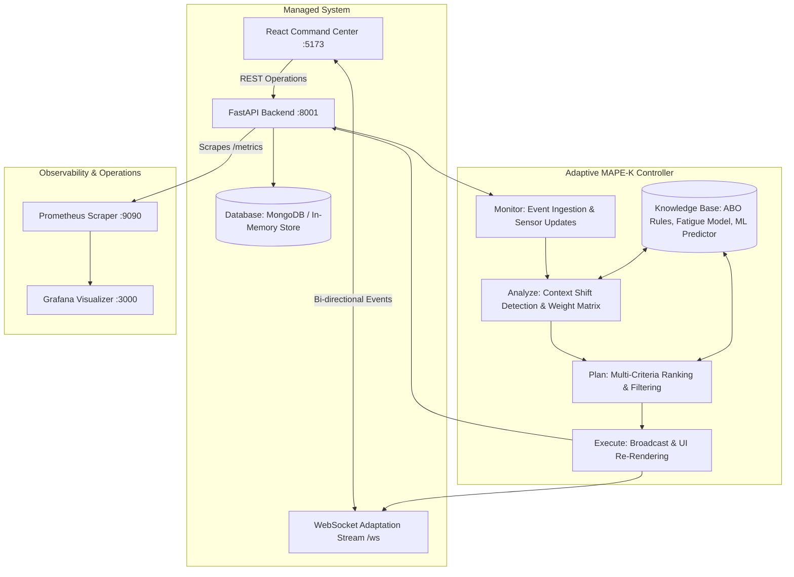
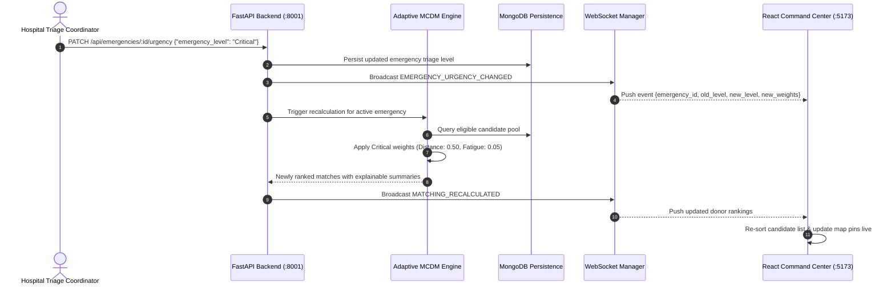

# System & Adaptive Software Architecture

**AI-Adaptive Blood Donor Matching System**  
*Adaptive Software Engineering (ASE) Course Project*

---

> [!IMPORTANT]
> **Academic Decision-Support & Clinical Disclaimer**  
> This system is strictly an **academic donor coordination and recommendation support tool** for authorized healthcare personnel. It does **NOT** make or claim to make clinical transfusion decisions. Biological compatibility, laboratory cross-matching, donor blood safety testing, and transfusion eligibility must always be performed and authorized by licensed medical personnel in accordance with hospital standards.

---

## 1. High-Level Architectural Topology

The system implements a closed-loop adaptive architecture following the classical **MAPE-K (Monitor-Analyze-Plan-Execute over Shared Knowledge)** loop from autonomic computing and adaptive software engineering.

---

## 2. Adaptive MAPE-K Mapping

| Phase | System Implementation | Engineering Guarantee |
| :--- | :--- | :--- |
| **Monitor** | REST API endpoints intercept state changes (`PATCH /status`, `PATCH /location`, `PATCH /urgency`). WebSocket telemetry tracks active clients. | Real-time event ingestion with atomic database persistence prior to broadcast. |
| **Analyze** | `get_weights_for_emergency(level)` evaluates triage shift (`Routine` vs `Urgent` vs `Critical`) and calculates relative criteria weights. | Dynamic shifting: Distance weight moves $0.20 \to 0.35 \to 0.50$ as urgency escalates. |
| **Plan** | Multi-Criteria Decision Making (MCDM) engine filters incompatible/unavailable candidates, predicts response likelihood, scores fatigue, and computes composite priority scores. | Zero hardcoded black-box outputs; every ranking generates explainable rationales. |
| **Execute** | WebSocket `ConnectionManager` broadcasts `MATCHING_RECALCULATED` event. React frontend receives payload and hot-swaps ranking cards and map pins without page reload. | Zero-client resilience; stale client self-pruning without blocking HTTP threads. |
| **Knowledge** | Static ABO/Rh matrix rules, Haversine geo-algorithms, trained RandomForest response model, and recovery fatigue penalty formulas. | Deterministic reproducibility and clinically grounded compatibility definitions. |

---

## 3. Real-Time Event Driven Synchronization

---

## 4. Architectural Resilience Guarantees

1. **In-Memory Graceful Fallback**: If MongoDB is offline or inaccessible during local academic evaluation, the system automatically pivots to an asynchronous in-memory data store with zero crash impact.
2. **Resilient Broadcast Pipeline**: WebSocket broadcasting runs in safe exception boundaries; zero connected clients or sudden disconnects do not impact core REST API responses.
3. **Card-Level Idempotency**: Multi-attribute updates (e.g., updating location and availability concurrently) recalculate active emergencies exactly once to avoid event duplication.
4. **Data Governance & PII Isolation**: Prometheus metrics explicitly mask all patient and donor Personally Identifiable Information (PII).
