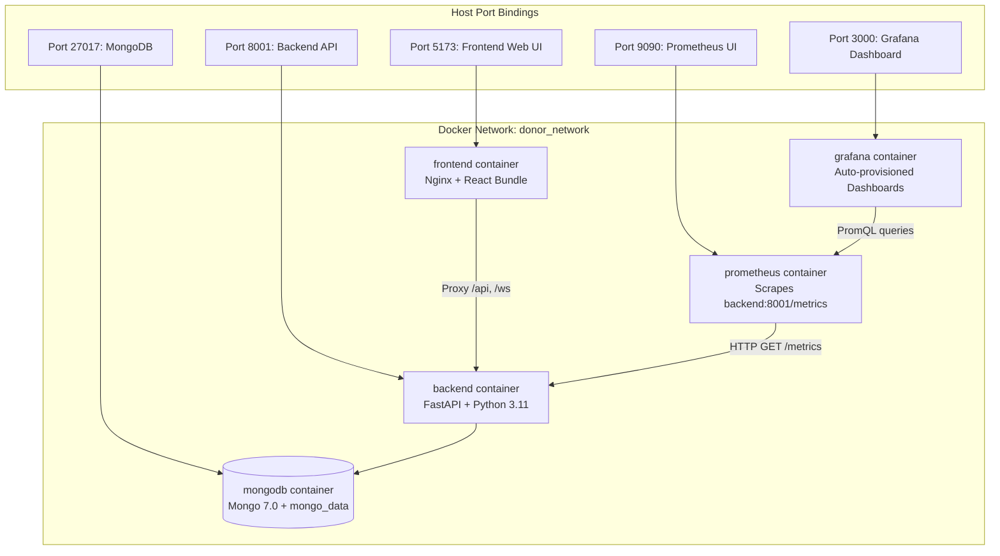
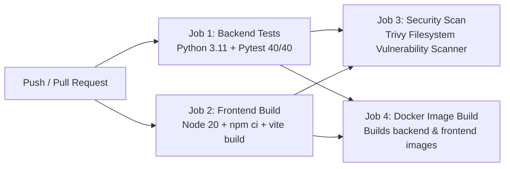

# DevOps, Containerization & CI/CD Pipeline

**AI-Adaptive Blood Donor Matching System**

---

## 1. Multi-Container Orchestration Architecture

The system is fully containerized using Docker and Docker Compose. All 5 services communicate over an isolated bridge network (`donor_network`).



---

## 2. Docker Service Definitions

| Service | Base Image | Port Binding | Volume Mounts | Healthcheck |
| :--- | :--- | :--- | :--- | :--- |
| **mongodb** | `mongo:7.0` | `27017:27017` | `mongo_data:/data/db` | `mongosh --eval "db.adminCommand('ping')"` |
| **backend** | `python:3.11-slim` | `8001:8001` | None (self-contained) | `curl -f http://localhost:8001/health` |
| **frontend** | `node:20-alpine` $\to$ `nginx:alpine` | `5173:5173` | None (static build) | `wget -q -O - http://localhost:5173/` |
| **prometheus** | `prom/prometheus:v2.50.0` | `9090:9090` | `./monitoring/prometheus/prometheus.yml` | Native |
| **grafana** | `grafana/grafana:10.4.0` | `3000:3000` | `./monitoring/grafana/provisioning/` + `grafana_data` | Native |

### Security & Operational Best Practices
- **Non-Root Execution**: Backend runs under unprivileged user `appuser`.
- **Multi-Stage Build**: Frontend builds with Node.js in Stage 1 and copies only static assets to minimal Alpine Nginx in Stage 2.
- **Port Compliance**: Frontend serves directly on port `5173` with reverse proxy to backend `/api`, `/ws`, and `/health`.
- **Persistent Storage**: MongoDB uses named Docker volume `mongo_data` to preserve donor records across restarts.

---

## 3. GitHub Actions CI/CD Pipeline

Configured in `.github/workflows/ci.yml`. Triggers on every `push` and `pull_request` to `main` and `master`.



### Job Descriptions
1. **Backend Test Suite**:
   - Sets up Python 3.11 with pip caching.
   - Installs dependencies from `backend/requirements.txt`.
   - Runs `python -m pytest tests/ -v`.
   - Fails if any test fails (no mocked success codes).
2. **Frontend Production Build**:
   - Sets up Node.js 20.x with npm package-lock caching.
   - Runs `npm ci` and `npm run build`.
   - Fails if compilation fails or bundle errors occur.
3. **Security Vulnerability Scan**:
   - Runs Aquasecurity Trivy in filesystem mode across the entire repository.
   - Audits for critical and high CVEs in dependencies.
4. **Docker Validation**:
   - Validates multi-stage Dockerfiles and builds container images without pushing.

---

## 4. Local Execution & Environment Verification

### Standard Docker Compose Deployment
```bash
docker compose build
docker compose up
```

### Local Development Mode (Without Docker Daemon)
If running on an academic machine where the Docker daemon is not installed:
1. **Backend**:
   ```powershell
   backend\venv\Scripts\python.exe -m uvicorn app.main:app --host 0.0.0.0 --port 8001
   ```
2. **Frontend**:
   ```powershell
   cd frontend
   npm run dev
   ```
