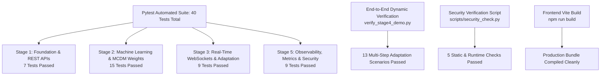

# Comprehensive Automated Testing & Verification Suite

**AI-Adaptive Blood Donor Matching System**

---

## 1. Test Suite Architecture

The system enforces automated regression testing across all five project stages. All tests execute without mock shortcuts or hardcoded success overrides.

---

## 2. Test Breakdown by Stage

### Stage 1: Backend Foundation & REST APIs (`tests/test_stage1.py`)
- `test_root_endpoint`: Verifies status, documentation links, and academic disclaimer.
- `test_health_endpoint`: Verifies database connection mode and record counts.
- `test_get_donors_list`: Verifies donor retrieval and seeding.
- `test_filter_donors_by_blood_group`: Verifies ABO/Rh query filtering.
- `test_get_single_donor_and_404`: Verifies donor lookup and 404 response on nonexistent IDs.
- `test_create_update_delete_donor`: Verifies full CRUD lifecycle for donors.
- `test_emergency_lifecycle`: Verifies emergency creation, urgency escalation, and fulfillment.

### Stage 2: Machine Learning & Adaptive Matching Engine (`tests/test_stage2.py`)
- `test_compatible_donor_is_considered`: Compatible donors pass ABO/Rh matrix.
- `test_incompatible_donor_is_filtered`: Incompatible donors are filtered out.
- `test_unavailable_donor_is_filtered`: Offline/unavailable donors are filtered out.
- `test_ineligible_donor_is_filtered`: Medically ineligible donors are excluded.
- `test_distance_calculation`: Haversine formula and ETA calculations.
- `test_ml_predictor_returns_probability_between_0_and_1`: Validates probability boundary $[0.0, 1.0]$.
- `test_routine_weights_applied`: Verifies Routine weights ($w_{comp}=0.40, w_{dist}=0.20, w_{ml}=0.20, w_{fatigue}=0.20$).
- `test_urgent_weights_applied`: Verifies Urgent weights ($w_{comp}=0.30, w_{dist}=0.35, w_{ml}=0.25, w_{fatigue}=0.10$).
- `test_critical_weights_applied`: Verifies Critical weights ($w_{comp}=0.20, w_{dist}=0.50, w_{ml}=0.25, w_{fatigue}=0.05$).
- `test_ranking_changes_when_emergency_level_changes`: Validates dynamic re-ranking on triage escalation.
- `test_ranking_changes_when_donor_location_changes`: Validates re-ranking on donor mobility.
- `test_ranking_changes_when_donor_availability_changes`: Validates re-ranking when top donor goes offline.
- `test_matching_api_get_weights`: API endpoint returns configured weight matrices.
- `test_matching_api_endpoint_execution`: Integration test for `GET /api/matching/{id}`.
- `test_matching_api_404_on_nonexistent_emergency`: 404 verification.

### Stage 3: Real-Time WebSockets & Adaptation Events (`tests/test_stage3.py`)
- `test_websocket_connection_succeeds`: Validates `/ws` connection.
- `test_websocket_ping_pong`: Validates client keepalive.
- `test_websocket_client_disconnect_handled`: Clean unregistration of severed sockets.
- `test_donor_availability_change_generates_event`: Emits `DONOR_STATUS_CHANGED`.
- `test_donor_location_change_generates_event`: Emits `DONOR_LOCATION_CHANGED`.
- `test_emergency_urgency_adaptation_weights_and_recalculation`: Emits `EMERGENCY_URGENCY_CHANGED` and `MATCHING_RECALCULATED`.
- `test_donor_response_event`: Emits `DONOR_RESPONSE_RECEIVED`.
- `test_rest_operations_succeed_with_zero_connected_clients`: Zero-client tolerance.
- `test_no_duplicate_recalculation_events_on_combined_update`: Idempotent recalculation guarantee.

### Stage 5: Observability, Metrics & Security (`tests/test_stage5.py`)
- `test_metrics_endpoint_returns_prometheus_format`: Validates `/metrics` format.
- `test_http_requests_total_increments`: Validates HTTP throughput metric.
- `test_matching_metrics_recorded`: Validates matching calculation latency & counter.
- `test_emergency_creation_metric`: Validates emergency counter with urgency & blood group labels.
- `test_donor_dynamics_metrics`: Validates status and mobility counters.
- `test_websocket_gauge_metric`: Validates active connection gauge lifecycle ($0 \to 1 \to 0$).
- `test_metrics_do_not_leak_pii`: Validates ethical health data governance.
- `test_security_headers_present`: Validates `X-Content-Type-Options` and `X-Frame-Options`.
- `test_input_boundary_validation`: Validates 422 errors on invalid coordinates, age, and blood units.

---

## 3. End-to-End Verification Results

Executed via `backend/verify_stage4_demo.py`:
- **Step 0**: Reset donor database to 20 benchmark records $\to$ Passed.
- **Step A**: Create an O+ Routine emergency at Victoria Hospital $\to$ Passed.
- **Step B**: Load ranked donors (6 evaluated candidates) $\to$ Passed.
- **Step C**: Select #1 top donor (Dr. Aarav Patel) $\to$ Passed.
- **Step D**: Verify score breakdown & Routine weights $\to$ Passed.
- **Step E**: Escalate Routine $\to$ Critical via REST API $\to$ Passed.
- **Step F**: Verify adaptive weights shift via WebSocket $\to$ Passed.
- **Step G**: Verify real-time re-ranking without page reload $\to$ Passed.
- **Step H**: Toggle top donor to UNAVAILABLE $\to$ Passed.
- **Step I**: Verify status broadcast & runner-up donor promoted to #1 $\to$ Passed.
- **Step J**: Move backup donor closer to hospital $\to$ Passed.
- **Step K**: Verify `DONOR_LOCATION_CHANGED` coordinate broadcast $\to$ Passed.
- **Step L**: Verify updated transit ETA (5.4 mins) and priority score $\to$ Passed.
- **Step M**: Verify all adaptation events captured in activity stream $\to$ Passed.

**Summary**: 40/40 Pytest Passed | 13/13 Demo Steps Passed | 5/5 Security Checks Passed | Frontend Build Passed (0.97s).
